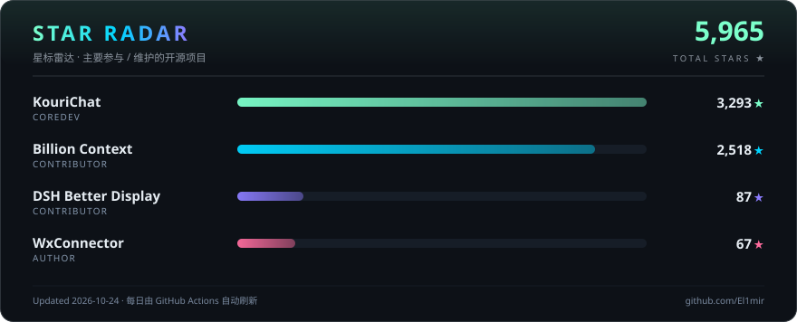

  

  
  
  
   
  
  
  

 

## ✦ 关于我 · About me

> **16 岁高中生 · 全栈开发者 · Vibe coder**  
> **16 y/o high-school student · full-stack developer · vibe coder**
>
> 我喜欢把想法做成真正可用的软件，关注体验、性能和开源协作。  
> I turn ideas into useful software with a focus on experience, performance, and open-source collaboration.

## 🛠️ 当前状态 · Now building

  

## 📬 联系我 · Say hello

  
  
  

## ⚡ 技术栈 · Stack I use

  

  
  

## 🧠 模型与 Vibe Coffee · Models + Vibe Coffee

  

  
  

  
  
  

## 📊 贡献驾驶舱 · Contribution cockpit

  
  

  

### 🧬 代码构成 · Code mix

<table align="center" border="0" cellspacing="0" cellpadding="6">
  <tr>
    <td align="center"></td>
    <td align="center"></td>
  </tr>
  <tr>
    <td align="center"></td>
    <td align="center"></td>
  </tr>
</table>

## ⭐ 星标雷达 · Star radar

  

> 汇总我主要参与 / 维护的开源项目星标，每日由 GitHub Actions 自动刷新。  
> Star counts across the open-source projects I maintain or contribute to — refreshed daily by GitHub Actions.

<b>📈 Star 增长趋势 · Star growth</b>

  

## 🚀 精选项目 · Selected projects

  
  

  
  

| 项目 · Project | 角色 · Role |
| --- | --- |
| [KouriChat](https://github.com/KouriChat/KouriChat) | Coredev · 核心开发 |
| [BiliNote](https://github.com/El1mir/BiliNote) | Unofficial current repo · 非官方当前仓库 |
| [Billion Context](https://github.com/ranxianglei/billion-context) | Contributor · 贡献者 |
| [DSH Better Display](https://github.com/aa2246740/dsh-better-display) | Contributor · 贡献者 |

## 🧭 个人时间线 · Timeline

| 年份 · Year | 里程碑 · Milestone |
| --- | --- |
| 2020 | 开始编程 · Started programming |
| 2024 | 加入 KouriChat，成为 Coredev · Joined KouriChat as Coredev |
| 2026 | 参与 Billion Context、DSH Better Display 与 DeepSeek Harness 社区生态 · Contributed to Billion Context, DSH Better Display, and the DeepSeek Harness ecosystem |
| Now | 维护 CryoAlchemists，优化 DSH 工作流，开发新工具 · Maintaining the forum, improving DSH workflows, and shipping tools |

  

  

## 💜 致谢 · Acknowledgements

  

> 感谢 **[Kouri API](https://api.kourichat.com)** 为我的 Vibe Coding 提供 Token 支持。  
> Thanks to **[Kouri API](https://api.kourichat.com)** for powering my vibe coding with token support.

 

  

